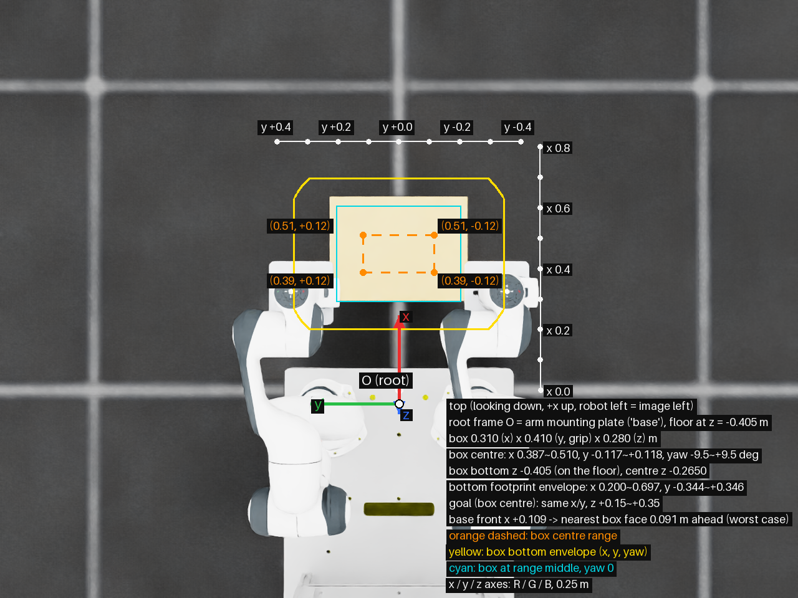
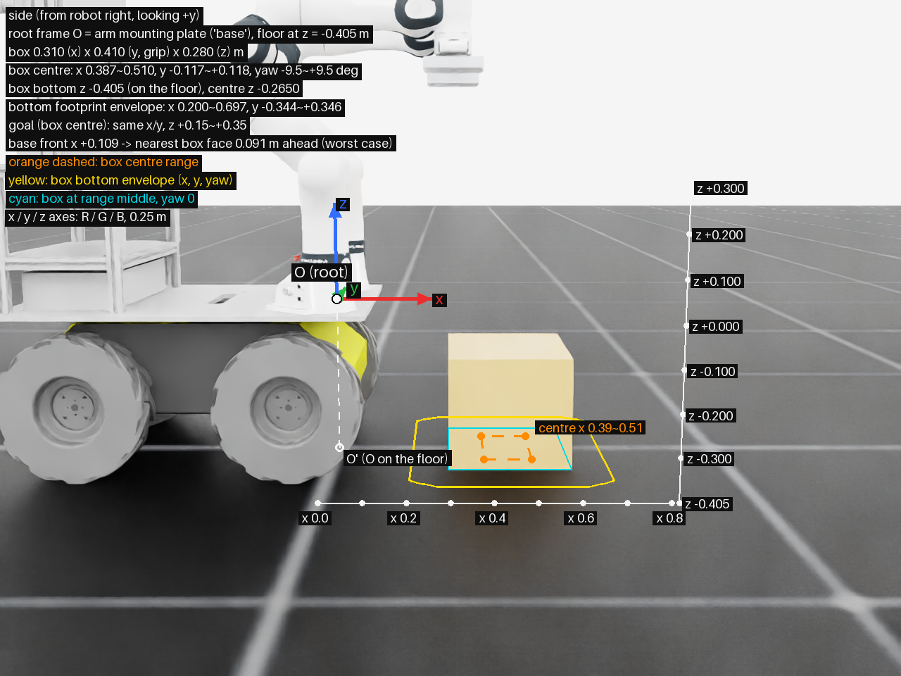
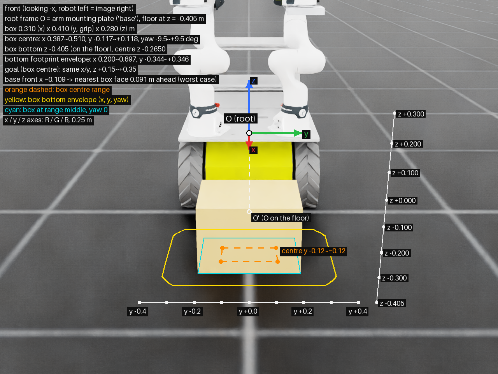
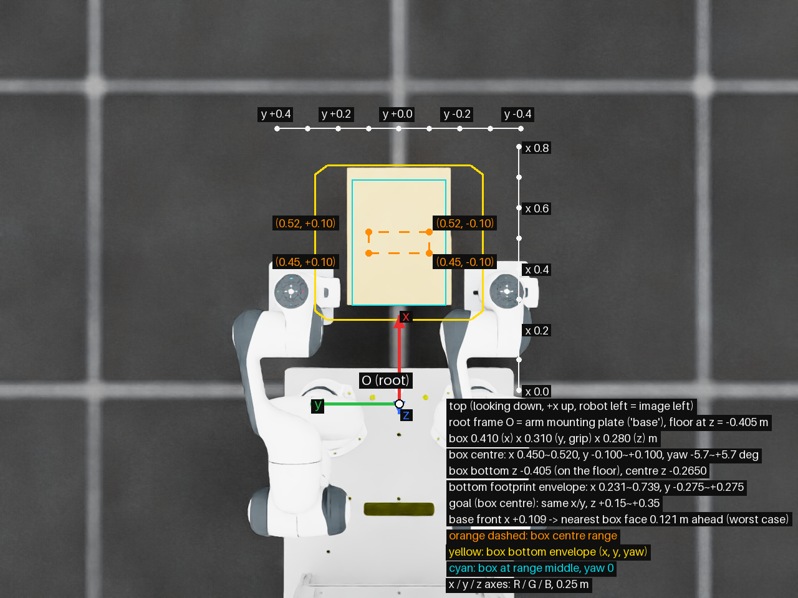
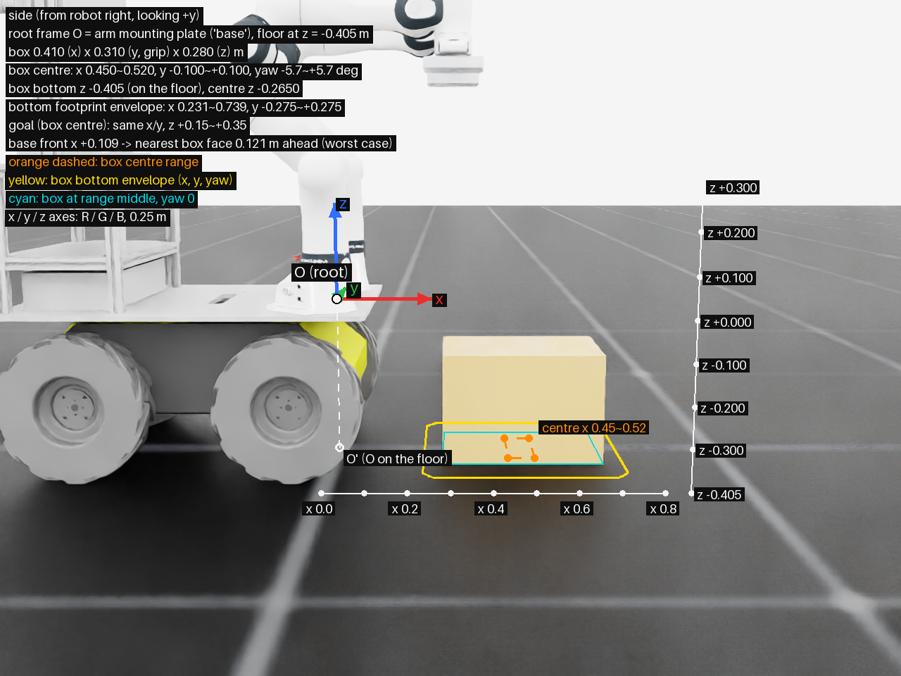
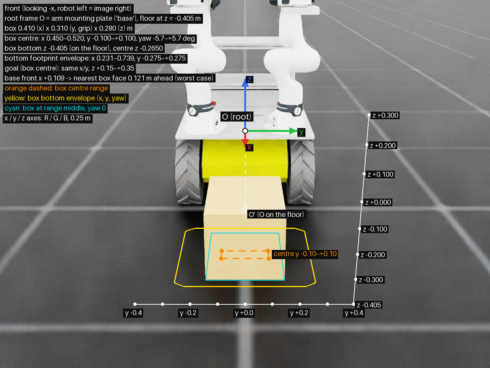
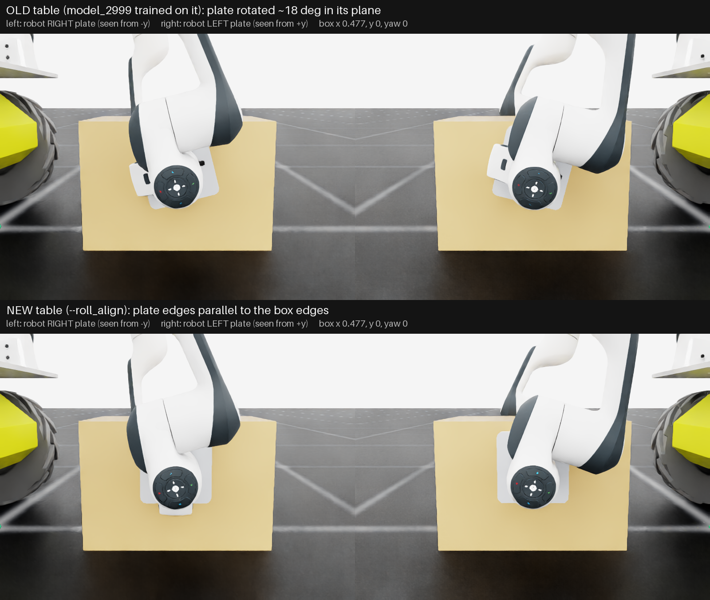

# box410 실로봇 배치 기준 (2026-11-03)

box lift 정책이 학습한 박스 위치를 실로봇에서 재현하기 위한 좌표 기준이다. 박스는 실물 2차 박스(410 × 310 × 280 mm, 0.4~0.6 kg)다.

- **지금 기준은 긴 변(410 mm)을 좌우로 놓는 Wide다**: `Isaac-Lift-Box-DualFR3-Plate-Sim2Real-100Hz-Light-Pregrasp-Wide-v0`, `-Light-Pregrasp-Wide-RollAlign-v0`. "Wide" 절이다.
- 그 아래 "410 mm 앞뒤 배치"는 앞서 학습한 `-Light-Box410-v0`, `-Light-Pregrasp-v0`의 기준이다. 실물 박스를 90° 돌려 놓아야 한다.
- 좌표계 정의는 두 배치에 같다("좌표계" 절).

## 좌표계

- 원점 O는 로봇 root frame `base`다. 팔 장착 상판 윗면에 있다.
  - 두 팔의 장착점(link0 원점)이 (0, ±0.215, 0)이다. 즉 **O는 두 팔 장착점을 이은 선의 중점**이다.
- 축: x 로봇 정면, y 로봇 왼쪽, z 위.
- 정책의 박스 pose 관측과 goal은 모두 이 frame 기준이다. 실로봇 노드(`fr3_husky_nn_policy.boxlift_core`)도 같은 `base` frame을 쓴다.
- 바닥은 z = −0.405 m다(sim USD에서 팔 장착면이 바닥 위 0.405 m). **실물에서 한 번 재서 확인해야 한다.**
- Husky 몸체 가장 앞부분은 x = +0.109 m다.

### 실물 URDF와 대조 (2026-11-04)

- Isaac USD의 원본 `fr3_ws/dual_fr3.urdf`와 실물 `fr3_husky_description/robots/dual_fr3.urdf.xacro`(`mobile:=true`)를 전개해 비교했다.
  - base → link0은 둘 다 (0, ±0.215, 0), yaw ±30°이고, 팔 관절 원점도 같다.
  - Isaac에서 ready 자세의 link7 위치가 URDF FK와 같다: (0.3069, ±0.215, 0.6973), z축은 아래.
  - 판 EE: URDF `plate_ee`는 link8(link7 + 0.107) 위 25 mm, 140 × 140 mm다. Isaac TCP는 link7 + 0.132로 같다.
- **다른 점은 바닥 높이 하나다.**
  - URDF의 바퀴 collision 원통(반지름 0.1651) 기준으로는 바닥이 z −0.392다.
  - Isaac은 바퀴 visual mesh 아래 끝에 맞춰 −0.405로 스폰했다.
  - 실물이 0.392라면 박스가 base 기준 1.3 cm 높게 놓인다. sim에서 root를 0.392로 내려 평가해도 Wide 두 정책 모두 성공 100%였다. 판 중심과 박스 중심의 높이 차만 약 1.2 cm 줄었다.
- `base`가 이 frame이 되려면 `mobile:=true`로 띄워야 한다.
  - controller launch를 단독으로 띄울 때 기본값은 `load_mobile:=false`다. 이때 `base`는 팔 ±0.34, yaw 0인 다른 frame이 된다.
  - box lift launch는 `load_mobile` 기본값이 true라 맞다.

## Wide: 긴 변 좌우 (2026-11-03)

```bash
python scripts/tools/draw_box_workspace.py --viz none \
    --task Isaac-Lift-Box-DualFR3-Plate-Sim2Real-100Hz-Light-Pregrasp-Wide-Play-v0 --out_dir docs/figures --prefix box410wide_workspace
```

| 위 (+x 위쪽, 로봇 왼쪽 = 화면 왼쪽) | 옆 (로봇 오른쪽에서 +y 방향으로) | 앞 (-x 방향으로, 로봇 왼쪽 = 화면 오른쪽) |
|---|---|---|
|  |  |  |

- 그림은 sim 화면 위에 좌표를 투영해 그렸다. 로봇은 ready 자세, 박스는 범위 한가운데(x 0.449, y 0, yaw 0)다.
- 화살표: x 빨강, y 초록, z 파랑, 길이 0.25 m. 흰 점 O가 원점, O'는 O를 바닥에 내린 점이다(위에서 보면 O와 겹친다).
- 주황 점선: 박스 **중심** 학습 범위. 노랑: x·y·yaw 범위 전체에서 박스 **밑면**이 차지할 수 있는 영역. 하늘색: 범위 한가운데, yaw 0일 때 밑면.
- Pregrasp task는 박스 위치를 시작 자세 표에서 뽑는다. 그림의 범위는 표의 박스 위치 범위에 리셋 노이즈(±1 cm, ±2.9°)를 더한 값이다.

| 항목 | 값 [m] (base frame) |
|---|---|
| 박스 크기 | x 0.310 (앞뒤) × y 0.410 (판이 잡는 방향) × z 0.280 |
| 박스 중심 x | 0.397 ~ 0.500 (노이즈 포함 0.387 ~ 0.510) |
| 박스 중심 y | −0.107 ~ +0.108 (노이즈 포함 ±0.117) |
| 박스 yaw | 노이즈 포함 −9.5° ~ +9.5° |
| 박스 밑면 z | −0.405 (바닥), 중심 z −0.265 |
| 로봇 쪽 면 x, yaw 0 | 중심 x − 0.155 → 0.242 ~ 0.345 |
| 판이 닿는 면 y, yaw 0 | 중심 y ± 0.205 |
| 밑면이 차지할 수 있는 영역 (노이즈·yaw 포함) | x 0.200 ~ 0.697, y −0.344 ~ +0.346 |
| goal (박스 중심) | x·y는 시작 위치 그대로, z +0.15 ~ +0.35 |

- x를 0.40~0.50으로 잡은 이유: 박스 폭이 410 mm라 판이 y ±0.245까지 벌어진다. x 0.50 이상에서는 j2가 한계에 닿아 시작 자세 표의 유효율이 66%로 떨어진다. 0.40~0.48은 거의 100%다.
- Husky 앞(x 0.109)에서 로봇 쪽 면까지는 x 최소(노이즈 포함 0.387), yaw 0일 때 12.3 cm, 노이즈·yaw를 모두 넣은 최악에서 9.1 cm다.

### Wide 박스 놓는 방법

1. O'와 로봇 중심선은 아래 410 mm 앞뒤 배치의 "실물에 놓는 방법" 1~2번과 같다.
2. 박스의 410 mm 변을 중심선에 **수직**으로 놓는다. 판은 박스 양 끝의 310 × 280 mm 면을 잡는다.
3. 로봇 쪽 면(310 mm 변)을 후보의 "로봇 쪽 면 x"에 맞추고, 박스 중심을 중심선 위에 둔다.
4. 시작 자세 후보(정책 npz의 표에서 `pregrasp_start_poses.py`로 뽑음):

| 후보 | 표 줄 | 박스 중심 (x, y, yaw) | 로봇 쪽 면 x | 관절 여유 |
|---|---|---|---|---|
| **A** (첫 시험) | 1965 | 0.448, −0.001, −0.7° | 0.293 | 0.102 rad |
| B | 2790 | 0.419, −0.003, −0.5° | 0.264 | 0.140 rad |
| C | 2166 | 0.477, +0.002, 0.0° | 0.322 | 0.065 rad |
| D | 371 | 0.447, +0.047, +0.9° | 0.292 | 0.096 rad |
| E | 1257 | 0.451, −0.052, +0.9° | 0.296 | 0.069 rad |

- 두 정책(Wide, Wide-RollAlign)의 표는 박스 pose와 j1~j6이 같고 j7만 다르다. 관절각과 `move_to_joint` 명령은 `fr3_husky_etri/docs/dual_fr3_box_experi_step.md` 맨 아래와 각 정책의 `*_start_poses.yaml`에 있다.
- 노드 launch에 `box_size_m:="[0.310, 0.410, 0.280]"`을 준다. 기본값(410 앞뒤)이면 Wide 정책 로드가 거부된다.
- sim 확인: 이 다섯 줄에서 노이즈 없이 500 env, DR·외란 켜고 두 정책 모두 성공 100%였다. FR3 한계 여유 최소는 Wide-RollAlign 0.129, Wide 0.112 rad다.

## 410 mm 앞뒤 배치 (Light-Box410, Pregrasp)

그림은 `scripts/tools/draw_box_workspace.py`로 sim 화면 위에 좌표를 투영해 그렸다. 로봇은 ready 자세이고, 박스는 학습 범위 한가운데(x 0.485, y 0, yaw 0)에 놓았다.

```bash
python scripts/tools/draw_box_workspace.py --viz none \
    --task Isaac-Lift-Box-DualFR3-Plate-Sim2Real-100Hz-Light-Box410-Play-v0 --out_dir docs/figures --prefix box410_workspace
```

| 위 (+x 위쪽, 로봇 왼쪽 = 화면 왼쪽) | 옆 (로봇 오른쪽에서 +y 방향으로) | 앞 (-x 방향으로, 로봇 왼쪽 = 화면 오른쪽) |
|---|---|---|
|  |  |  |

### 박스 학습 범위

| 항목 | 값 [m] (base frame) |
|---|---|
| 박스 크기 | x 0.410 (앞뒤) × y 0.310 (판이 잡는 방향) × z 0.280 |
| 박스 중심 x | 0.450 ~ 0.520 |
| 박스 중심 y | −0.100 ~ +0.100 |
| 박스 yaw | −5.7° ~ +5.7° (±0.1 rad) |
| 박스 밑면 z | −0.405 (바닥), 중심 z −0.265 |
| 로봇 쪽 면(밑면 뒷변) x, yaw 0 | 0.245 ~ 0.315 (Husky 앞에서 13.6 ~ 20.6 cm) |
| 먼 쪽 면 x, yaw 0 | 0.655 ~ 0.725 |
| 밑면이 차지할 수 있는 영역 (yaw 포함) | x 0.231 ~ 0.739, y −0.275 ~ +0.275 |
| goal (박스 중심) | x·y는 시작 위치 그대로, z +0.15 ~ +0.35 (41.5 ~ 61.5 cm 들기) |

- Pregrasp는 같은 범위의 표에서 시작 자세를 뽑고, 리셋 때 박스에 ±1 cm, ±2.9°(0.05 rad)를 더 흔든다.
- 판은 140 × 140 mm이고, Pregrasp는 판 중심이 박스 중심보다 5 cm 높은 곳(바닥에서 19 cm)을 잡는다.

### 실물에 놓는 방법

1. O' 표시: 두 팔 장착점의 중점에서 바닥으로 수선을 내려 바닥에 표시한다.
2. 로봇 중심선 표시: O'에서 로봇 정면(x) 방향으로 선을 긋는다.
3. 박스 배치: 박스의 410 mm 변을 이 선과 나란하게 놓는다.
   - 로봇 쪽 면이 O'에서 0.245 ~ 0.315 m 앞에 오게 한다. 이때 박스 중심 x는 0.45 ~ 0.52다.
   - 박스 중심이 중심선에서 좌우 ±0.10 m 안에 오게 한다.
4. 처음 시험은 범위 한가운데에 둔다: 로봇 쪽 면이 O'에서 0.28 m 앞(중심 x 0.485), 중심선 위(y 0), yaw 0.
5. 비전/모캡 박스 pose가 이 값과 맞는지 확인하고 시작한다.
   - 박스 frame 원점은 박스 중심이다. x는 410 mm 변, y는 310 mm 변 방향이다.
   - 노드의 `start_position_margin_m` 검사는 이 범위를 기준으로 한다.

- x 0.50 이상을 쓰지 않아도 된다. 학습 범위 0.45 ~ 0.52의 앞쪽 대부분이 0.50 아래다.
- Pregrasp 시작 자세 표도 x 0.45 ~ 0.50에서 99%가 유효하다. 0.50 ~ 0.52는 92%다.

### Pregrasp model_2999 실물 시험 (2026-11-03)

- 정책: `fr3_husky_etri/model/dual_fr3_boxlift_pregrasp_box410_model2999.npz` (`export_boxlift_actor.py`, `manifest["start"]` = `pregrasp_table`).
- 시작 자세: `fr3_husky_etri/model/dual_fr3_boxlift_pregrasp_box410_model2999_start_poses.yaml`.
  - `scripts/tools/pregrasp_start_poses.py`로 만들었다. 학습 표에서 요청한 박스 위치에 가장 가까운 줄을 골라, 그 줄의 박스 pose와 양팔 관절각, `move_to_joint` 명령을 적는다.

| 요청 박스 (x, y, yaw) | 표 줄 | 실제 박스 중심 (x, y, yaw) | 로봇 쪽 면 x | 관절 여유 (Margin 한계까지) |
|---|---|---|---|---|
| 0.46, 0.00, 0° | 1919 | 0.460, −0.001, 0.0° | 0.255 | 0.106 rad |
| 0.48, 0.00, 0° | 3788 | 0.477, +0.000, 0.0° | 0.272 | 0.083 rad |
| 0.50, 0.00, 0° | 3925 | 0.498, −0.003, −0.3° | 0.293 | 0.052 rad |
| 0.48, +0.05, 0° | 720 | 0.479, +0.052, 0.0° | 0.274 | 0.066 rad |
| 0.48, −0.05, 0° | 2228 | 0.481, −0.051, +0.3° | 0.276 | 0.061 rad |

- sim 확인: 이 다섯 줄에서 노이즈 없이 시작해 500 env를 돌렸다(질량·마찰 DR, 외란 켬).
  - 성공 100%, 성공까지 1.40 s, 끝 기울기 4.7°, 박스 yaw 0.4°, 최대 판 힘 16 N, 판 외 접촉 0, FR3 한계 여유 최소 0.115 rad.
- 순서
  1. 박스 없이 `move_to_joint`로 양팔을 그 줄의 관절각으로 보낸다. 이동은 RL과 무관하다.
     - `MoveToJoint`는 박스를 모르므로, 박스를 먼저 두면 판이 박스를 지나갈 수 있다.
  2. 박스를 표의 위치에 놓는다. 판이 박스 면에서 4 cm 바깥이므로, 로봇 앞쪽(+x)에서 두 판 사이로 밀어 넣는다.
     - 학습 노이즈가 ±1 cm, ±3°이므로 그 안에 둔다.
  3. RL 노드를 시작한다. 박스 pose(`/box_pose`)는 들기 동안에도 계속 들어와야 한다. 정책 관측에 박스 위치·자세가 매 step 들어간다.
- 노드 설정
  - 시작 검사: 노드가 매니페스트의 `start.mode`(`pregrasp_table`)를 보고 팔·박스가 표의 한 줄에 맞는지 본다(관절 0.03 rad, 박스 ±1 cm, ±0.05 rad). `ready_tolerance_rad`는 쓰지 않는다.
  - 에피소드는 4 s로 학습했다.
  - goal 높이는 학습 범위 0.15~0.35의 최솟값 0.15(기본값)로 시작한다.
- 이 checkpoint는 기존 표(판이 면 안에서 18° 돌아감)로 학습했다. 시작 자세도 기존 표에서 뽑아야 한다. 새 표(`--roll_align`)의 관절각은 이 정책에 쓰지 않는다.


